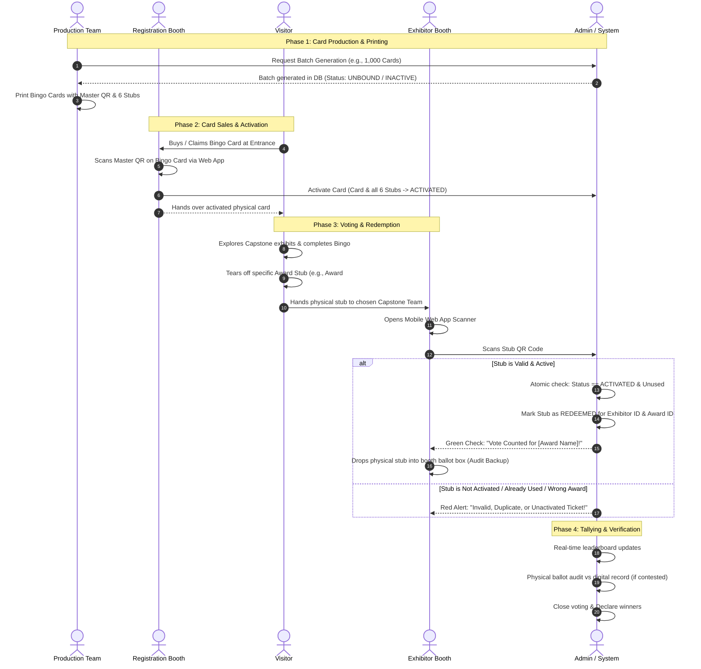

# Itechtivity 2027 — Capstone Awards & Bingo Voting System
## System Concept & Architectural Blueprint

---

## 1. Executive Summary

**Itechtivity 2027** is an annual event celebrating the graduating class's capstone projects. To drive visitor engagement and ensure transparent, tamper-proof voting for up to **6 capstone awards**, the event combines a physical **Gamified Bingo Card** with a **Digital QR Verification & Tallying Web Application**.

### Key Objectives
* **Visitor Gamification:** Visitors receive a Bingo Card that incentivizes them to explore multiple booths and complete activities.
* **Fair & Transparent Voting:** Each Bingo Card contains **6 detachable voting stubs** (one per award category) with cryptographically secured QR codes.
* **Fraud Prevention:** Multi-tier physical and cryptographic safeguards guarantee that counterfeit, duplicate, or unactivated tickets cannot be cast.
* **Modern Web Stack:** Built on **Next.js (App Router)** and **PostgreSQL**, optimized for mobile browsers so exhibitors can scan tickets instantly without downloading a native app.

---

## 2. The Physical-Digital Hybrid Mechanism

```
+-------------------------------------------------------------+
|                     ITECHTIVITY 2027                        |
|                  OFFICIAL BINGO CARD                        |
|                                                             |
|   Serial No: B27-08492        [ Master QR Activation ]      |
|                                                             |
|   +-----------------------+-----------------------------+   |
|   |                       |                             |   |
|   |      BINGO GRID       |     RULES & INSTRUCTIONS    |   |
|   |   (Booths to visit    |                             |   |
|   |    & stamp/verify)    |                             |   |
|   |                       |                             |   |
|   +-----------------------+-----------------------------+   |
|                                                             |
|=================== PERFORATION LINE ========================|
|  [Stub 1: Award 1]  |  [Stub 2: Award 2]  | [Stub 3: Award 3]  |
|  Best Innovation    |  Best UI/UX         | Best Tech Arch     |
|   [ QR Code #1 ]    |   [ QR Code #2 ]    |   [ QR Code #3 ]   |
|  STUB-08492-A1      |  STUB-08492-A2      |  STUB-08492-A3     |
|---------------------+---------------------+-----------------|
|  [Stub 4: Award 4]  |  [Stub 5: Award 5]  | [Stub 6: Award 6]  |
|  People's Choice    |  Best Presentation  | Best Social Impact |
|   [ QR Code #4 ]    |   [ QR Code #5 ]    |   [ QR Code #6 ]   |
|  STUB-08492-A4      |  STUB-08492-A5      |  STUB-08492-A6     |
+-------------------------------------------------------------+
```

### Component Breakdown
1. **Bingo Main Card:** Contains the visitor game grid (to win event freebies/rewards) and a **Master Activation QR**.
2. **6 Perforated Award Stubs:** Each stub is physically torn off and handed to an exhibitor. Each stub contains:
   * Human-readable Award Name & Serial Number.
   * Unique, cryptographically signed Single-Use QR Code.
   * Category constraint (e.g., Stub #1 can only cast a vote for Award #1).

---

## 3. User Roles & Permission Matrix

The system specifies **5 distinct actors**:

| Role | Key Responsibilities | Primary Interface | Auth Type |
| :--- | :--- | :--- | :--- |
| **1. Admin** | Oversees entire event, configures awards, creates booth accounts, monitors live audit logs, manages system lock/freeze. | Desktop / Responsive Web Dashboard | Email/Password + 2FA / Session Cookie |
| **2. Production Account** | Generates batches of card/stub serials and cryptographic signatures; exports print-ready sheets/PDFs. | Web Dashboard (Export & Batching) | Secure Login with Batch Generation Permissions |
| **3. Registration Booth** | Sells/distributes bingo cards; scans Master QR to activate/bind cards into `ACTIVATED` state. | Fast Mobile/Tablet Web Scanner | Station Login / PIN with Session Timeout |
| **4. Exhibitor Account** | Capstone booth teams; scans physical stubs handed by visitors to log votes in real-time. | Mobile Web Scanner (Camera PWA) | Booth ID + Secure PIN or Magic Link |
| **5. Visitor / Public Screen** | (Read-only) Live leaderboard display or personal card verification screen. | Public Large Display / Visitor Mobile | Public / Ephemeral Token |

---

## 4. End-to-End Lifecycle Flow



---

## 5. Security & Authentication Architecture

To guarantee election integrity, we propose a **three-layered defense model**:

### 1. Account-Level Authentication (Web Application)
* **Admin & Production:** Standard credentials with secure HTTP-only cookies (`Iron-Session` or `Auth.js / NextAuth`) with CSRF protection and role-based route middleware.
* **Registration Stations:** Dedicated station tokens tied to physical devices with auto-lock timers to prevent unauthorized staff operations.
* **Exhibitors (Booth Teams):** 
  * Low-friction, high-security login: Each booth gets a unique **Booth Code + PIN** (or a one-click authenticated QR badge for booth managers).
  * Lock to booth: Exhibitors can *only* scan votes for their assigned booth ID.

### 2. Physical Stub Cryptography & Anti-Counterfeit
* **No Sequential Predictable IDs:** Never use raw database IDs like `card_id=105`.
* **High-Entropy Signed Tokens:**
  Each stub QR encodes an encrypted or signed payload:
  $$\text{Payload} = \text{base64url}(\text{StubUUID} \mathbin{\Vert} \text{AwardID} \mathbin{\Vert} \text{HMAC-SHA256}(\text{StubUUID} + \text{AwardID}, \text{SECRET\_KEY}))$$
* **Two-Phase Commit (Activation Requirement):**
  * Newly printed cards start in `INACTIVE` state.
  * Even if a batch of cards is stolen from the printing press, the stubs are **rejected** by the scanner until the **Registration Booth** scans the Master QR.
* **Single-Use Atomic Transaction (Anti-Double-Spend):**
  * When scanned, the database executes an atomic `UPDATE ... WHERE id = :id AND status = 'ACTIVATED'` with `FOR UPDATE` row lock.
  * Duplicate scans fail instantly, logging the exact timestamp, booth, and IP of the previous redemption.

### 3. Physical Fallback & Audit Trail (The Ballot Box)
* The physical stub must be placed in a **locked physical box** at each exhibitor's booth.
* If any exhibitor contests vote counts, Admin can perform a physical stub recount and match the serial numbers against database audit logs.

---

## 6. Proposed Database Schema (PostgreSQL)

```mermaid
erDiagram
    EVENT ||--o{ AWARD : contains
    EVENT ||--o{ BOOTH : participates
    EVENT ||--o{ BINGO_CARD : issues
    
    BINGO_CARD ||--|{ TICKET_STUB : contains
    
    BOOTH ||--o{ VOTE : receives
    AWARD ||--o{ VOTE : categorizes
    TICKET_STUB ||--o| VOTE : redeems
    USER ||--o{ BINGO_CARD : activates
    USER ||--o{ VOTE : logs

    USER {
        uuid id PK
        string username
        string role "ADMIN | PRODUCTION | REGISTRATION | EXHIBITOR"
        uuid booth_id FK "nullable"
        timestamp created_at
    }

    AWARD {
        uuid id PK
        string name "e.g., Best Capstone, Best UI/UX"
        int display_order
        boolean is_active
    }

    BOOTH {
        uuid id PK
        string name "Project Title"
        string code "e.g., CS-01"
        string members
        string category
    }

    BINGO_CARD {
        uuid id PK
        string serial_number UK "e.g., B27-1004"
        string activation_hash UK
        string status "GENERATED | ACTIVATED | CANCELLED"
        uuid activated_by FK
        timestamp activated_at
    }

    TICKET_STUB {
        uuid id PK
        uuid bingo_card_id FK
        uuid award_id FK
        string stub_serial UK "e.g., B27-1004-A1"
        string signature_hash
        string status "INACTIVE | ACTIVATED | REDEEMED"
    }

    VOTE {
        uuid id PK
        uuid ticket_stub_id FK UK
        uuid booth_id FK
        uuid award_id FK
        uuid recorded_by_user_id FK
        timestamp created_at
    }
```

---

## 7. Technology Stack Selection

* **Frontend & Backend Framework:** **Next.js (App Router)** with TypeScript
  * Unified full-stack repository (Server Actions + API routes).
  * Rapid UI development with **Tailwind CSS** and **shadcn/ui**.
  * Responsive Mobile First scanner view for booth tablets/smartphones.
* **Database & ORM:** **PostgreSQL** + **Prisma ORM** (or **Drizzle ORM**)
  * ACID transactions and row-level locking for concurrency protection.
* **Camera / QR Scanner Library:** `@zxing/library` or `html5-qrcode`
  * Fast native camera integration in any mobile web browser without app store installations.
* **Card & Stub Generation Engine:** `@react-pdf/renderer` or `pdfkit`
  * Automatically lays out print-ready sheets with high-resolution vector QR codes ready for professional printing.
* **Real-time Engine:** Server-Sent Events (SSE) or WebSockets
  * Powers real-time Admin live dashboards and tally screens without manual refresh.

---

## 8. Open Design Questions & Clarifications

To tailor this architecture specifically to your vision, here are key points to consider:

1. **Award Binding to Stubs:**
   * *Option A (Category-Fixed Stubs):* Each stub is explicitly labelled (e.g., "Stub 1: Best UI/UX", "Stub 2: People's Choice"). A visitor cannot give two votes for "People's Choice".
   * *Option B (Wildcard Stubs):* Stubs are generic "Vote 1 to 6". The exhibitor chooses or the visitor designates which award they are voting for at the moment of scanning.
   * *(Recommendation: Option A enforces balanced distribution across all 6 awards).*

2. **Exhibitor Multi-Award Voting:**
   * Can a single visitor vote for the *same* booth across multiple award categories (e.g. give their "Best UI/UX" AND "People's Choice" to Team A), or must each award go to different booths?

3. **Visitor Identification at Registration:**
   * Should the registration booth capture visitor details (Name, Student ID, Email) when binding the card, or should it remain completely anonymous for speed and privacy?

4. **Live Results Display:**
   * Will the tally be hidden until the formal awards ceremony, or will there be a real-time public leaderboard on a projector during the event?
