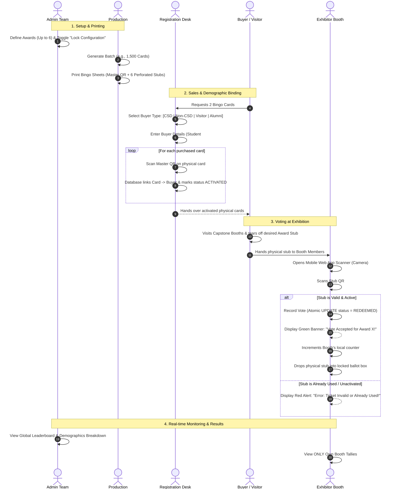

# Itechtivity 2027 — Capstone Awards & Bingo Voting System
## System Concept & Technical Specification

---

## 1. Executive Summary

**Itechtivity 2027** is an annual university showcase where graduating students present their capstone projects. The event features a gamified **Bingo Card** for visitors and a digital **Voting & Tallying System** for up to **6 Capstone Awards**.

Visitors purchase physical Bingo Cards at the registration counter. Each card includes the main interactive bingo grid plus **6 detachable voting stubs** equipped with secure QR codes. Visitors tear off these stubs and present them to exhibitor booths to cast their votes. Exhibitors scan the QR stubs with their smartphones to register the vote in real-time.

---

## 2. Key System Clarifications & Rules

### 1. Award Assignment & Lock System
* **Configurable Slots (Up to 6 Awards):** The event supports up to 6 awards (names and criteria to be finalized closer to event date).
* **Pre-Assignment & Lock Mechanism:**
  * **Generic Mode (Unlocked):** Stubs are designated by slot number (`Slot 1` through `Slot 6`).
  * **Locked / Pre-Assigned Mode:** Admin binds each slot to a definitive Award (e.g., `Slot 1` = "Best Innovation", `Slot 2` = "Best UI/UX") and activates the **Configuration Lock**. Once locked, the generation/printing pipeline hardcodes the award names and cryptographic category signatures onto the physical stubs.
* **Multi-Award Booth Eligibility:** A visitor **can** give multiple different award stubs to the *same* exhibitor booth (e.g., Booth A can receive a visitor's "Best UI/UX" stub AND their "Best Innovation" stub). However, a single card contains only one stub per award slot.

### 2. Visitor Registration & Buyer Demographics
When selling and binding Bingo Cards at the Registration Booth, the system records the buyer's category and demographic information to ensure transparency, prevent botting/scalping, and provide attendance analytics:

* **CSD Student:** Current students under the College of Science & Department of Computer Studies.
  * Required Data: Student Number, Full Name, Program (BSCS, BSIT, etc.), Year & Section, Quantity Purchased.
* **Non-CSD Student:** Students from other departments/colleges across the campus.
  * Required Data: Student ID, Full Name, College/Department, Program, Quantity Purchased.
* **Visitor:** External guests, industry partners, family, high school visitors.
  * Required Data: Full Name, Affiliation / Organization / Guest, Contact Number / Email, Quantity Purchased.
* **Alumni:** Former CSD graduates returning as guests or industry evaluators.
  * Required Data: Full Name, Graduating Batch Year, Degree Program, Contact Info, Quantity Purchased.

* **Multi-Card Binding:** A single purchaser transaction can buy $N$ cards. The registration scanner reads $N$ Master QRs sequentially to bind all $N$ cards to that single buyer record in one atomic operation.

### 3. Leaderboard & Visibility Permissions
* **Admin Account:** Has full visibility over the global live leaderboard, vote velocity, turnout by buyer category, and individual booth totals.
* **Exhibitor Account:** **Strictly Scoped.** Exhibitors can **only** see their own booth's live tally and scan history (e.g., "Our Booth: 14 Innovation votes, 8 UI/UX votes"). They cannot view competitor counts, preventing tactical tampering or demotivation during the exhibition.
* **Awards Ceremony Mode (Optional):** An Admin-activated public presentation view designed for projector display during the final awards ceremony, featuring animated reveals.

---

## 3. User Roles & Authentication

Authentication uses standard **Email + Password** credentials with secure, HTTP-only session cookies and Role-Based Access Control (RBAC).

* **Admin (`admin@itech2027.edu`):** Full control: Manage awards, lock config, create booths, view global leaderboard, freeze/audit voting.
* **Production (`prod@itech2027.edu`):** Batch generator: Generate serials, sign QR payloads, export print PDFs.
* **Registration (`reg.desk1@itech2027...`):** Sales counter: Register buyer info, scan & bind Master QRs in bulk.
* **Exhibitor (`booth.cs01@itech20...`):** Booth scanner: Web camera scanner, view own booth tally only.

---

## 4. Physical & Digital Security Architecture

```
                   +--------------------------------------------+
                   |          TWO-PHASE BINDING MODEL           |
                   +--------------------------------------------+
                                         |
      [Phase 1: Production]              v
      +---------------------------------------------------------+
      | Status: INACTIVE / UNBOUND                              |
      | - Generated with cryptographically random NanoIDs       |
      | - Signed with HMAC-SHA256 (SlotID + CardUUID + Secret)   |
      | - Unscannable by exhibitors (Will trigger "Unbound Err")|
      +---------------------------------------------------------+
                                         |
      [Phase 2: Registration]            v
      +---------------------------------------------------------+
      | Status: ACTIVATED & BOUND                               |
      | - Buyer demographic recorded (CSD, Non-CSD, etc.)       |
      | - Master QR scanned at counter                          |
      | - All 6 stubs atomically transition to ACTIVATED        |
      +---------------------------------------------------------+
                                         |
      [Phase 3: Exhibitor Scan]          v
      +---------------------------------------------------------+
      | Status: REDEEMED                                        |
      | - Validated via atomic DB row-lock (`FOR UPDATE`)       |
      | - Assigned to Exhibitor's booth_id                      |
      | - Marked REDEEMED (Double-scans rejected immediately)   |
      | - Physical stub dropped in booth ballot box             |
      +---------------------------------------------------------+
```

### Cryptographic QR Encoding
Each stub QR encodes a URL-safe compact payload:
$$\text{Payload} = \text{base64url}\left(\text{StubUUID} \mathbin{\Vert} \text{SlotNumber} \mathbin{\Vert} \text{HMAC-SHA256}(\text{StubUUID} + \text{SlotNumber}, K_{\text{event}})\right)$$

* **Tamper-Proof:** Visitors cannot modify the slot number or fabricate counterfeit QR codes without the server's private key $K_{\text{event}}$.
* **Anti-Double-Spend & One-Time Scan Guarantee:** The database enforces an atomic transition check:
  ```sql
  UPDATE "TICKET_STUB"
  SET "status" = 'REDEEMED', "updated_at" = NOW()
  WHERE "id" = :stub_id AND "status" = 'ACTIVATED'
  RETURNING *;
  ```
  If zero rows match (ticket was never activated or already redeemed), the transaction fails immediately. A database-level `UNIQUE(ticket_stub_id)` constraint on the `VOTE` table provides a second unbreachable layer of defense.
* **Idempotency Protocol (Network Drops & Retries):**
  * When an exhibitor scans a stub, the client sends an `Idempotency-Key: <booth_id>:<stub_serial>:<uuid>`.
  * If a flaky mobile network drops right after the server processes the vote but before the client receives the HTTP 200, the scanner will auto-retry with the same idempotency key.
  * The server recognizes the idempotency key and returns the original success response (`"Vote Accepted"`) instead of throwing an error or double-counting the vote.
* **Advance Batch Production & Appwrite Cloud Storage:**
  * Cards are generated **weeks in advance** of the event, avoiding any live server crunch.
  * Generated print-ready PDFs are streamed directly to **Appwrite Storage** (`bingo-cards-pdf` bucket). The production team downloads the vector PDFs from Appwrite for professional printing, perforating, and packaging.
* **Real-time Live Streaming via Appwrite Realtime (WebSockets):**
  * Clients (Admin leaderboard, Exhibitor booth dashboards) connect to **Appwrite Realtime** WebSockets.
  * When Next.js records a valid vote in PostgreSQL, it dispatches an event via the Appwrite Server SDK (`node-appwrite`). Appwrite handles WebSocket fan-out to hundreds of connected devices, freeing the application server from managing persistent socket connections.
* **Physical Backup:** Exhibitors keep the physical stubs in a sealed ballot box. If there is a dispute, the committee can match physical stubs against the database log.

---

## 5. System Sequence Flow



---

## 6. Proposed PostgreSQL Database Schema

```mermaid
erDiagram
    EVENT_CONFIG ||--o{ AWARD : configures
    USER ||--o{ REGISTRATION_TRANSACTION : processes
    USER ||--o{ BOOTH : assigned_to

    REGISTRATION_TRANSACTION ||--|{ BINGO_CARD : activates
    BINGO_CARD ||--|{ TICKET_STUB : contains
    
    AWARD ||--o{ TICKET_STUB : pre_assigned_to
    BOOTH ||--o{ VOTE : receives
    TICKET_STUB ||--o| VOTE : registers
    USER ||--o{ VOTE : scanned_by

    EVENT_CONFIG {
        uuid id PK
        string event_name
        boolean is_awards_locked
        int max_awards "Default 6"
        boolean is_voting_open
    }

    AWARD {
        uuid id PK
        int slot_number "1 to 6"
        string title "e.g. Best Capstone, Best UI/UX"
        string description
        boolean is_active
    }

    USER {
        uuid id PK
        string email UK
        string password_hash
        string full_name
        string role "ADMIN | PRODUCTION | REGISTRATION | EXHIBITOR"
        uuid booth_id FK "nullable"
        timestamp created_at
    }

    BOOTH {
        uuid id PK
        string code UK "e.g. CS-01"
        string project_title
        string capstone_category
        string team_members
        string table_number
    }

    REGISTRATION_TRANSACTION {
        uuid id PK
        uuid processed_by_user_id FK
        string buyer_type "CSD_STUDENT | NON_CSD_STUDENT | VISITOR | ALUMNI"
        string buyer_name
        string student_number "nullable"
        string program "nullable"
        string year_and_section "nullable"
        string affiliation "nullable"
        string contact_info "nullable"
        int quantity_bought
        timestamp created_at
    }

    BINGO_CARD {
        uuid id PK
        string card_serial UK "e.g. B27-0104"
        string master_qr_hash UK
        uuid transaction_id FK "nullable until bound"
        string status "GENERATED | ACTIVATED | VOID"
        timestamp activated_at
    }

    TICKET_STUB {
        uuid id PK
        uuid bingo_card_id FK
        int slot_number "1 to 6"
        uuid award_id FK "nullable if generic, populated if locked"
        string stub_serial UK "e.g. B27-0104-S1"
        string signature_hash
        string status "INACTIVE | ACTIVATED | REDEEMED"
    }

    VOTE {
        uuid id PK
        uuid ticket_stub_id FK UK
        uuid booth_id FK
        uuid award_id FK
        uuid scanned_by_user_id FK
        timestamp scanned_at
    }
```

---

## 7. Technology Stack & Implementation Highlights

* **Framework:** **Next.js 15 (App Router, TypeScript)**
* **Database:** **PostgreSQL** hosted on Supabase, Neon, or local Docker.
* **ORM:** **Prisma** (for type-safe schema modeling, migrations, and transactions).
* **Authentication:** **NextAuth.js (Auth.js) / Iron Session** with Email + Password credentials, role-based middleware guards (`/admin/*`, `/registration/*`, `/exhibitor/*`, `/production/*`).
* **In-Browser QR Scanner:** **`html5-qrcode`** or **`@zxing/library`** (supports native camera selection, torch/flashlight toggle, and fast continuous scanning).
* **Printable PDF Generator:** **`@react-pdf/renderer`** or **Puppeteer** (generates standard letter/A4 printable sheets with high-DPI vector QR codes and perforation cut guidelines).
* **UI & Styling:** **Tailwind CSS** + **shadcn/ui** with responsive mobile-first layouts.
* **Real-time Engine:** **Server-Sent Events (SSE)** or **PostgreSQL Change Data Capture** for Admin live tally updates.

---

## 8. Summary of Completed Decisions & Next Steps

|Area|Status / Decision|
|---|---|
|**Authentication**|Email + Password with Role-Based Access Control (Admin, Production, Registration, Exhibitor).|
|**Award Assignment**|Generic 6-slot stubs with Admin pre-assignment and lock capability.|
|**Voting Flexibility**|One card = 6 separate award stubs. A visitor can award multiple different stubs to the same booth.|
|**Registration Tracking**|Multi-type demographic collection (CSD, Non-CSD, Visitor, Alumni) with batch card binding.|
|**Leaderboard Visibility**|Admin gets full real-time tally. Exhibitor views only their own booth's scans.|

### Ready to proceed with:
1. Setting up the Next.js project with PostgreSQL + Prisma.
2. Generating the Prisma schema matching the database design.
3. Building the authentication system and role routing.
